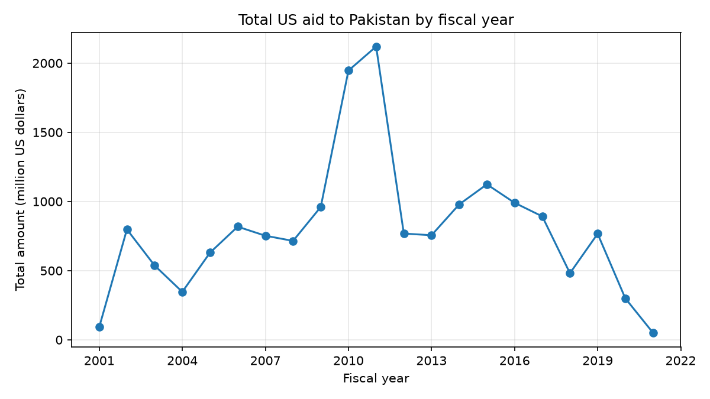
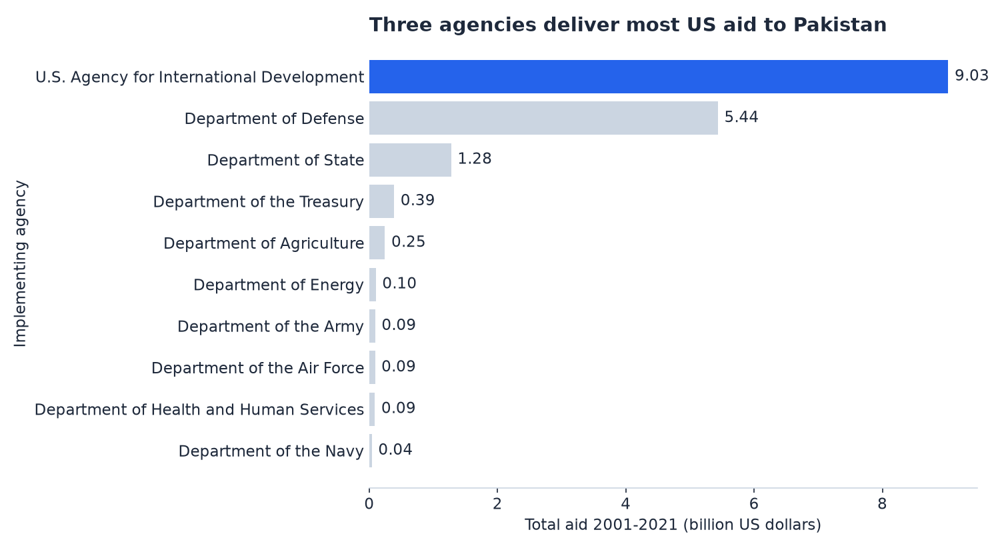
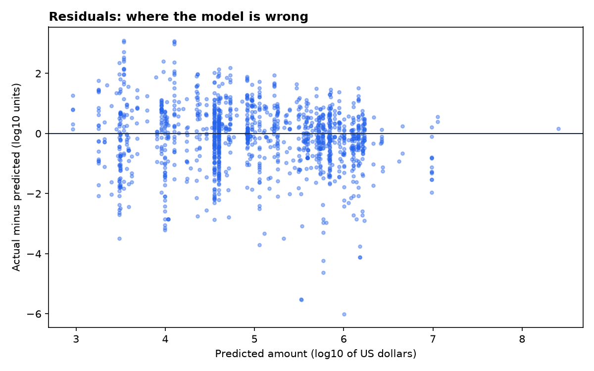

# US Aid to Pakistan: Data Quality & Insights Pipeline (Part A)

Name:Shah fahad Roll no:TRN-2026-000706

## Dataset
- US Aid to Pakistan (2001-2021), 8,297 rows and 21 columns
- Source URL: https://opendata.com.pk/dataset/us-aid-to-pakistan
- Licence: Not visible without a login on the source page (checked 19-11-2026). My TA confirmed on 20-11-2026 that the dataset can be used for this assignment.
- Access date: 19-11-2026
- Raw file: `data/raw/us_aid_pakistan.csv` (never edited)

## Setup
python -m venv .venv
.venv\Scripts\Activate.ps1
python -m pip install -r requirements.txt

## How to run (from the project folder, in this order)
```
python -m src.run_pipeline      # clean, validate, save cleaned data and metrics
python -m src.quality_report    # readable before/after report
python -m src.analysis          # Pandas and NumPy summaries
python -m src.charts            # three charts
python -m src.sql_query         # SQLite query
python -m src.train             # compare baseline, Ridge and Random Forest
python -m src.evaluate          # error analysis, residual plot, save the pipeline
python -m src.make_sample_rows  # make a small file of unseen rows
python -m src.predict data/new_rows_sample.csv outputs/predictions.csv
python -m pytest                # tests
```

## What the pipeline does
1. Removes 3 duplicate rows (8,297 -> 8,294).
2. Converts the two date columns to real dates.
3. Fills missing `subagency_acronym` (4.0%) with "Unknown".
4. Flags 383 negative amounts instead of deleting them.
5. Validates that key columns have no missing values and that `fiscal_year` is between 2001 and 2021. The pipeline stops with an error if this fails.

Before and after numbers are in `outputs/reports/data_quality_metrics.json`.
Decisions and limitations are in `docs/assumptions.md`. The schema is in `docs/schema.md`.

## Charts

Total aid was highest in 2011 (about 2,120 million) and fell after that.


Economic aid was larger than military aid in most years, and both peaked around 2010-2011.


USAID (about 9.0 billion), the Department of Defense (about 5.4 billion) and the Department of State (about 1.3 billion) delivered most of the aid.

## SQL query (SQLite)
The query is in `sql/aid_by_type.sql`. It groups the cleaned table by `aid_type_group_name` and counts records, sums amounts and averages them.

Result: Project-Type is the largest group (5,529 records, about 13.7 billion in total). Debt relief has only 2 records, but its average is very large (about 194 million) because each record is a big amount. Totals include negative amounts, so they are net amounts.

# Part B: Tabular ML Baseline

## Problem
Regression: predict the size of a US aid record (`current_amount`) from its agency, sector, aid type and fiscal year. The target is modelled on a log10 scale. The 383 negative rows are left out of modelling.

## Split
Time-based: fiscal years 2001-2017 for training (6,560 rows) and 2018-2021 for testing (1,351 rows). The split happens before any fitting. The test set is used once at the end.

## Pipeline
One scikit-learn Pipeline: imputation, one-hot encoding, scaling, then the model. Fitted on training data only. Code in `src/pipeline.py`.

## Results (test set, log10 scale)
| Model | CV MAE | Test MAE | Test RMSE | Test R2 |
|---|---|---|---|---|
| Baseline (median) | 1.017 | 1.007 | 1.312 | -0.012 |
| Ridge | 0.878 | 0.833 | 1.116 | 0.267 |
| Random Forest | 1.305 | 0.792 | 1.078 | 0.316 |

Random Forest is slightly the best, but a typical prediction is still about 6 times too high or too low. Details, error analysis, intended use and risks are in `docs/assumptions.md` (model card).


The errors are centred near zero but widely spread. The largest errors are tiny records (1 to 100 dollars) predicted as hundreds of thousands.

## Inference
The saved pipeline is `outputs/models/aid_amount_pipeline.joblib`. `src/predict.py` reads a CSV of new rows, checks the columns, and writes predictions to a new CSV.

## Tools used
I used Claude (Anthropic) to explain errors and concepts and to help draft code. I ran and tested everything.

## Part C
Part C (exploration homework) was not attempted.
