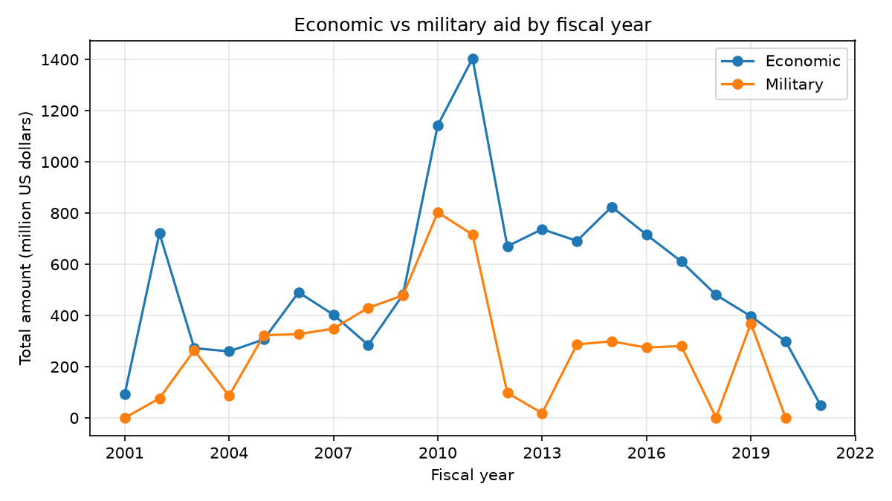

# US Aid to Pakistan: Data Quality & Insights Pipeline (Part A)

Name:Shah fahad Roll no:TRN-2026-000706

## Dataset
- US Aid to Pakistan (2001-2021), 8,297 rows and 21 columns
- Source URL: https://opendata.com.pk/dataset/us-aid-to-pakistan
- Licence: CC BY (to be confirmed on the source page)
- Access date: 19-11-2026
- Raw file: `data/raw/us_aid_pakistan.csv` (never edited)

## Setup
```
python -m venv .venv
.venv\Scripts\Activate.ps1
python -m pip install -r requirements.txt
```

## How to run (from the project folder, in this order)
```
python -m src.run_pipeline    # clean, validate, save cleaned data and metrics
python -m src.analysis        # Pandas and NumPy summaries
python -m src.charts          # three charts
python -m src.sql_query       # SQLite query
python -m pytest              # tests
```

## What the pipeline does
1. Removes 3 duplicate rows (8,297 -> 8,294).
2. Converts the two date columns to real dates.
3. Fills missing `subagency_acronym` (4.0%) with "Unknown".
4. Flags 383 negative amounts instead of deleting them.
5. Validates that key columns have no missing values and that `fiscal_year` is between 2001 and 2021. The pipeline stops with an error if this fails.

Before and after numbers are in `outputs/reports/data_quality_metrics.json`.
Decisions and limitations are in `docs/assumptions.md`. The schema is in `docs/schema.md`.

## Charts

Total aid was highest in 2011 (about 2,120 million) and fell after that.


Economic aid was larger than military aid in most years, and both peaked around 2010-2011.


USAID (about 9.0 billion), the Department of Defense (about 5.4 billion) and the Department of State (about 1.3 billion) delivered most of the aid.

## SQL query (SQLite)
The query is in `sql/aid_by_type.sql`. It groups the cleaned table by `aid_type_group_name` and counts records, sums amounts and averages them.

Result: Project-Type is the largest group (5,529 records, about 13.7 billion in total). Debt relief has only 2 records, but its average is very large (about 194 million) because each record is a big amount. Totals include negative amounts, so they are net amounts.

## Tools used
I used Claude (Anthropic) to explain errors and concepts and to help draft code. I ran and tested everything and I can explain each part.